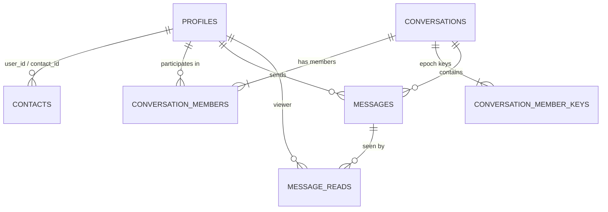

# Phase 1 Data Model: Bloop Windows Chat Application

**Feature**: `001-private-talk-chat`  
**Date**: 2026-11-19  
**Backend**: Supabase (PostgreSQL + RLS + Storage + Realtime)  
**Client Storage**: Windows DPAPI (`%LOCALAPPDATA%\PrivateTalk\session.dpapi`) & Rust Zeroized In-Memory Cache

---

## 1. Entity-Relationship Overview



---

## 2. Supabase PostgreSQL Entities

### 2.1 `profiles` (User Account & Cryptographic Identity)

Linked 1-to-1 with `auth.users.id`. Holds public identity metadata and the client-side password-wrapped private key backup blob.

| Field | Type | Constraints | Description |
|-------|------|-------------|-------------|
| `id` | `uuid` | `PK`, `REFERENCES auth.users(id) ON DELETE CASCADE` | User UUID assigned by Supabase Auth |
| `username` | `citext` | `UNIQUE NOT NULL`, `CHECK (username ~ '^[a-zA-Z0-9_]{3,32}$')` | Immutable case-insensitive unique username |
| `display_name` | `text` | `NOT NULL`, `CHECK (char_length(display_name) BETWEEN 1 AND 64)` | Mutable user display name |
| `avatar_path` | `text` | `NULL` | Object path in `avatars` Storage bucket |
| `public_enc_key` | `bytea` | `NOT NULL`, `CHECK (octet_length(public_enc_key) = 32)` | `X25519` public key for ECDH key wrapping |
| `public_sign_key` | `bytea` | `NOT NULL`, `CHECK (octet_length(public_sign_key) = 32)` | `Ed25519` public key for verifying signatures |
| `wrapped_priv_keys` | `bytea` | `NOT NULL` | `ChaCha20-Poly1305` encrypted `(x25519_priv \|\| ed25519_priv)` wrapped with Argon2id+HKDF `key_wrapping_key` |
| `kdf_salt` | `bytea` | `NOT NULL`, `CHECK (octet_length(kdf_salt) = 16)` | 128-bit random salt used for Argon2id derivation |
| `created_at` | `timestamptz` | `NOT NULL DEFAULT now()` | Account creation timestamp |
| `updated_at` | `timestamptz` | `NOT NULL DEFAULT now()` | Profile last updated timestamp |

---

### 2.2 `contacts` (Mutual Contact Entry)

Represents a symmetric mutual contact relationship established immediately when User A adds User B by exact username match (FR-002, FR-003). Stored as a normalized pair `(user_a, user_b)` where `user_a < user_b` (or two symmetric rows via database trigger/RPC) so both users immediately see each other in their contact lists.

| Field | Type | Constraints | Description |
|-------|------|-------------|-------------|
| `user_id` | `uuid` | `PK`, `REFERENCES public.profiles(id) ON DELETE CASCADE` | Owner side of contact view |
| `contact_id` | `uuid` | `PK`, `REFERENCES public.profiles(id) ON DELETE CASCADE`, `CHECK (user_id <> contact_id)` | Target contact user ID |
| `created_at` | `timestamptz` | `NOT NULL DEFAULT now()` | Timestamp when mutual contact was established |

*Rule*: Inserting `(A, B)` via the `add_mutual_contact(target_username)` RPC atomically inserts both `(A, B)` and `(B, A)`.

---

### 2.3 `conversations` (1-to-1 and Group Chat Metadata)

Represents either a 1-to-1 chat (`is_group = false`) or a Group Chat (`is_group = true`).

| Field | Type | Constraints | Description |
|-------|------|-------------|-------------|
| `id` | `uuid` | `PK DEFAULT gen_random_uuid()` | Conversation UUID |
| `is_group` | `boolean` | `NOT NULL DEFAULT false` | `false` for 1-to-1, `true` for Group Chat |
| `name` | `text` | `NULL`, `CHECK (NOT is_group OR (name IS NOT NULL AND char_length(name) BETWEEN 1 AND 80))` | Mutable group name (`NULL` for 1-to-1 chats) |
| `direct_pair_key` | `text` | `UNIQUE NULL` | Deterministic `"<min_uuid>:<max_uuid>"` for 1-to-1 chats to prevent duplicate 1-to-1 threads |
| `host_id` | `uuid` | `NULL REFERENCES public.profiles(id)` | Group creator/host (`NOT NULL` when `is_group = true`) |
| `current_epoch` | `integer` | `NOT NULL DEFAULT 1`, `CHECK (current_epoch >= 1)` | Active encryption key epoch (increments on member leave/removal) |
| `created_at` | `timestamptz` | `NOT NULL DEFAULT now()` | Creation timestamp |
| `updated_at` | `timestamptz` | `NOT NULL DEFAULT now()` | Updated on new message or group rename |

---

### 2.4 `conversation_members` (Active Membership Roster)

Tracks active participants in a conversation and their join order (used for automatic host succession if the host leaves).

| Field | Type | Constraints | Description |
|-------|------|-------------|-------------|
| `conversation_id` | `uuid` | `PK`, `REFERENCES public.conversations(id) ON DELETE CASCADE` | Conversation ID |
| `user_id` | `uuid` | `PK`, `REFERENCES public.profiles(id) ON DELETE CASCADE` | Member User ID |
| `joined_at` | `timestamptz` | `NOT NULL DEFAULT now()` | Used for earliest-joined host succession |
| `added_by` | `uuid` | `NOT NULL REFERENCES public.profiles(id)` | Member who added this participant |

---

### 2.5 `conversation_member_keys` (Per-Member Wrapped Epoch Keys)

Stores the `ConversationEpochKey` for each `(conversation_id, epoch)` wrapped individually for each member's `X25519` public key.
- When a new member is added to a group (FR-008), the adding member inserts wrapped keys for all epochs `1..=current_epoch` for the new member so they can decrypt full chat history.
- When a member leaves or is removed by the host (FR-009, FR-015), `current_epoch` increments and new wrapped keys for `current_epoch` are created only for remaining members.

| Field | Type | Constraints | Description |
|-------|------|-------------|-------------|
| `conversation_id` | `uuid` | `PK`, `REFERENCES public.conversations(id) ON DELETE CASCADE` | Conversation ID |
| `epoch` | `integer` | `PK`, `CHECK (epoch >= 1)` | Key generation epoch number |
| `recipient_id` | `uuid` | `PK`, `REFERENCES public.profiles(id) ON DELETE CASCADE` | Member who can unwrap this key |
| `distributor_id` | `uuid` | `NOT NULL REFERENCES public.profiles(id)` | Member who wrapped and signed this key |
| `ephemeral_pub_key` | `bytea` | `NOT NULL`, `CHECK (octet_length(ephemeral_pub_key) = 32)` | Ephemeral `X25519` public key used for ECDH |
| `nonce` | `bytea` | `NOT NULL`, `CHECK (octet_length(nonce) = 12)` | 96-bit `ChaCha20-Poly1305` nonce |
| `wrapped_key` | `bytea` | `NOT NULL`, `CHECK (octet_length(wrapped_key) = 48)` | 32-byte `ConversationEpochKey` + 16-byte Poly1305 tag |
| `signature` | `bytea` | `NOT NULL`, `CHECK (octet_length(signature) = 64)` | `Ed25519` signature by `distributor_id` |
| `created_at` | `timestamptz` | `NOT NULL DEFAULT now()` | Key wrapping timestamp |

---

### 2.6 `messages` (End-to-End Encrypted Messages & Media References)

Stores encrypted chat payloads. Plaintext message text and media filenames/bytes are never stored in dedicated plaintext columns; instead, an encrypted JSON envelope (`EncryptedMessageEnvelope`) holds `{ text, media_meta }` inside `ciphertext`.

| Field | Type | Constraints | Description |
|-------|------|-------------|-------------|
| `id` | `uuid` | `PK DEFAULT gen_random_uuid()` | Message UUID |
| `conversation_id` | `uuid` | `NOT NULL REFERENCES public.conversations(id) ON DELETE CASCADE` | Target conversation |
| `sender_id` | `uuid` | `NOT NULL REFERENCES public.profiles(id)` | Author of the message |
| `epoch` | `integer` | `NOT NULL` | Conversation key epoch used to encrypt this message |
| `nonce` | `bytea` | `NULL`, `CHECK (is_removed OR octet_length(nonce) = 12)` | 96-bit AEAD nonce (`NULL` when removed) |
| `ciphertext` | `bytea` | `NULL`, `CHECK (is_removed OR ciphertext IS NOT NULL)` | `ChaCha20-Poly1305` encrypted `EncryptedMessageEnvelope` (`NULL` when removed) |
| `signature` | `bytea` | `NULL`, `CHECK (is_removed OR octet_length(signature) = 64)` | `Ed25519` signature by `sender_id` (`NULL` when removed) |
| `media_object_path` | `text` | `NULL` | Object path in `chat-media` bucket (`NULL` for text-only or after removal) |
| `is_edited` | `boolean` | `NOT NULL DEFAULT false` | `true` after sender edits message text |
| `edited_at` | `timestamptz` | `NULL` | Timestamp of latest edit |
| `is_removed` | `boolean` | `NOT NULL DEFAULT false` | `true` when sender removes message (FR-010) |
| `removed_at` | `timestamptz` | `NULL` | Timestamp when message was wiped |
| `created_at` | `timestamptz` | `NOT NULL DEFAULT now()` | Original message timestamp |

#### Encrypted Payload Structure (`EncryptedMessageEnvelope` inside `ciphertext`)
Before encryption in Rust, the message body is serialized as compact JSON:
```json
{
  "text": "Hello team!",
  "attachment": {
    "mime_type": "video/mp4",
    "file_name": "demo.mp4",
    "size_bytes": 4194304,
    "media_nonce": "<base64-12-bytes>",
    "media_sha256": "<base64-32-bytes>"
  }
}
```
When `is_removed = true`:
- `ciphertext`, `nonce`, `signature`, and `media_object_path` are set to `NULL` in Postgres.
- Any corresponding encrypted blob in Supabase Storage (`chat-media`) is permanently deleted.
- All clients wipe any local decrypted cache for `message.id` and render `"Message removed"`.

---

### 2.7 `message_reads` (Per-Message Seen Receipts & Unread Tracking)

Records **who has seen each message** in a conversation and powers both the seen-by participant list and the Windows taskbar unread badge.

| Field | Type | Constraints | Description |
|-------|------|-------------|-------------|
| `conversation_id` | `uuid` | `PK`, `REFERENCES public.conversations(id) ON DELETE CASCADE` | Conversation ID |
| `message_id` | `uuid` | `PK`, `REFERENCES public.messages(id) ON DELETE CASCADE` | Message seen by user |
| `user_id` | `uuid` | `PK`, `REFERENCES public.profiles(id) ON DELETE CASCADE` | Viewer who saw the message |
| `seen_at` | `timestamptz` | `NOT NULL DEFAULT now()` | Exact timestamp when the message was seen |

---

## 3. Ephemeral Real-Time State (In-Memory Only, Zero DB Writes)

Managed by Rust via Supabase Realtime WebSocket channels:

1. **`OnlinePresenceState` (`presence:global` channel)**:
   - `user_id: Uuid`
   - `status: "online" | "offline"`
   - `online_at: DateTime<Utc>`
2. **`TypingIndicatorState` (`room:<conversation_id>` broadcast channel)**:
   - `conversation_id: Uuid`
   - `user_id: Uuid`
   - `is_typing: bool`
   - `expires_at: Instant` (auto-cleared after 3.5s if not refreshed)

---

## 4. Windows Local Protected State (Windows DPAPI)

Stored at `%LOCALAPPDATA%\PrivateTalk\session.dpapi`, encrypted via `CryptProtectData` bound to the current Windows user account:

```rust
pub struct DpapiProtectedSession {
    pub user_id: Uuid,
    pub username: String,
    pub supabase_access_token: String,
    pub supabase_refresh_token: String,
    pub x25519_private_key: [u8; 32], // ZeroizeOnDrop
    pub ed25519_private_key: [u8; 32], // ZeroizeOnDrop
    pub cached_epoch_keys: HashMap<(Uuid, i32), [u8; 32]>, // ZeroizeOnDrop
}
```

---

## 5. Validation Rules & State Transitions

### 5.1 Input & Media Validation Rules
- **Username**: `3..=32` ASCII alphanumeric/underscore characters, matched case-insensitively (`CITEXT`). Users cannot add themselves as a contact.
- **Avatar Upload**: Allowed formats `image/png`, `image/jpeg`, `image/webp`; strictly `<= 5 MB` (`5,242,880` bytes).
- **Chat Media Attachment**: Allowed formats `image/png`, `image/jpeg`, `image/webp`, `image/gif`, `video/mp4`, `video/webm`; strictly `<= 50 MB` (`52,428,800` bytes). Validated in Rust *before* reading into the encryption buffer.

### 5.2 Message State Transitions
- `Created (is_edited=false, is_removed=false)` -> `Edited (is_edited=true, is_removed=false)`: Only by `sender_id`. Replaces `ciphertext`, `nonce`, `signature` with re-encrypted payload.
- `Created / Edited` -> `Removed (is_removed=true, ciphertext=NULL, nonce=NULL, signature=NULL, media_object_path=NULL)`: Terminal state. Only by `sender_id`. Cannot be edited after removal.

### 5.3 Group Membership & Key Epoch Transitions
- **Create Group**: Creator becomes `host_id`; `current_epoch = 1`; creator generates `EpochKey(1)` and wraps for all initial members (must be in creator's `contacts`).
- **Add Member (by any current member)**: New member must be in the actor's `contacts`. Actor wraps historical keys `1..=current_epoch` for the new member. `current_epoch` stays unchanged.
- **Remove Member (by `host_id` only) or Member Leaves**:
  1. Target member row is deleted from `conversation_members`.
  2. If the leaving member was `host_id` and members remain, `host_id` transfers to the remaining member with the earliest `joined_at` timestamp (if no members remain, conversation closes).
  3. `current_epoch` increments to `current_epoch + 1`.
  4. Acting client generates fresh `EpochKey(current_epoch + 1)` and distributes wrapped keys exclusively to remaining members.
