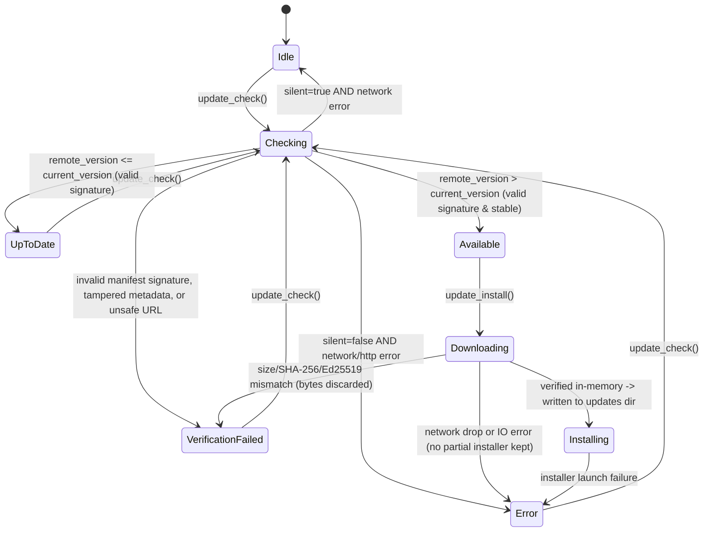

# Phase 1 Data Model: GitHub Release Distribution and In-App Auto-Update

**Feature**: `002-github-release-auto-update`  
**Date**: 2026-11-19  
**Source of Truth**: Rust Core (`src-tauri/src/updater/mod.rs`) & TypeScript IPC DTOs (`src/lib/types.ts`)

---

## 1. Update Lifecycle State Machine



---

## 2. Cryptographic & Domain Entities

### 2.1 `SemanticVersion` (Rust Value Object)

Strict parser and comparator for stable `MAJOR.MINOR.PATCH` release identifiers.

| Field | Type | Constraints | Description |
|-------|------|-------------|-------------|
| `major` | `u64` | Unsigned base-10 integer, no leading zeros unless `"0"` | Breaking release number |
| `minor` | `u64` | Unsigned base-10 integer, no leading zeros unless `"0"` | Feature release number |
| `patch` | `u64` | Unsigned base-10 integer, no leading zeros unless `"0"` | Patch release number |

**Validation Rules**:
- Optional single leading `"v"` prefix allowed when normalizing Git tags or manifest version fields; stripped before parsing.
- Must contain exactly 3 dot-separated ASCII digit components (`MAJOR.MINOR.PATCH`).
- Any pre-release (`-alpha`, `-rc.1`) or build metadata (`+build`) suffix is rejected for stable release enforcement (FR-002).
- Monotonic upgrade rule: update is offered **only** when `remote_version > current_version`. Equal or older versions transition to `UpToDate` (downgrade/rollback protection).

---

### 2.2 `ReleaseManifest` (`latest.json` on GitHub Releases)

Published alongside the Windows installer and detached `.sig` file on the GitHub Release page.

| Field | Type | Constraints | Description |
|-------|------|-------------|-------------|
| `version` | `String` | Valid `SemanticVersion` (`MAJOR.MINOR.PATCH`) | Target release semantic version |
| `published_at` | `DateTime<Utc>` | ISO-8601 UTC timestamp | Release publication timestamp |
| `notes` | `String` | `1..=4000` chars (trimmed) | Plain-text release notes summary shown to user |
| `draft` | `bool` | Must be `false` | Rejects draft releases if present (`true` fails closed) |
| `prerelease` | `bool` | Must be `false` | Rejects prereleases if present (`true` fails closed) |
| `installer_url` | `String` | `https://...` URL (loopback `http://127.0.0.1` / `http://localhost` allowed only in automated test config) | Direct HTTPS download URL for Windows x64 installer |
| `installer_file_name` | `String` | `[A-Za-z0-9._-]+`, ends with `.exe`, no `/`, `\`, or `..` | Safe local filename inside `%LOCALAPPDATA%\PrivateTalk\updates\` |
| `installer_size_bytes` | `u64` | `1..=104_857_600` (max 100 MiB) | Expected exact byte size of the Windows installer |
| `installer_sha256` | `String` | Exactly 64 lowercase hex chars (`[0-9a-f]{64}`) | Expected SHA-256 digest of the Windows installer binary |
| `signature` | `String` | Base64-encoded 64-byte `Ed25519` signature | Maintainer signature over canonical payload |

**Canonical Signing Payload** (`UTF-8` LF-delimited string):
```text
privatetalk-update-v1
{version}
{installer_sha256}
{installer_size_bytes}
```
Note: `version` is normalized without leading `v`, `installer_sha256` is lowercase 64-char hex, and `installer_size_bytes` is decimal unsigned integer.

---

### 2.3 `UpdatePhase` (Rust & TypeScript Enum)

Serialized in `snake_case` across Tauri IPC:

| Variant | Wire String | Meaning |
|---------|-------------|---------|
| `Idle` | `"idle"` | Initial state or suppressed transient silent startup error |
| `Checking` | `"checking"` | Querying GitHub Release `latest.json` manifest |
| `UpToDate` | `"up_to_date"` | Verified manifest matches or is older than current version |
| `Available` | `"available"` | Verified newer stable release discovered |
| `Downloading` | `"downloading"` | Downloading installer bytes into bounded Rust memory buffer |
| `Installing` | `"installing"` | Verified bytes written to `updates\` dir; launching installer & closing app |
| `VerificationFailed` | `"verification_failed"` | Fail-closed rejection: invalid signature, digest mismatch, size mismatch, or tampered manifest |
| `Error` | `"error"` | Network, HTTP, or local filesystem launch error (no unverified binary persisted) |

---

### 2.4 `UpdateStatusDto` (Tauri IPC & Event Payload)

Shared DTO exposed to the WebView via `update_get_status`, `update_check`, `update_install`, and `updater:state_changed` event.

| Field | Rust Type | TypeScript Type | Description |
|-------|-----------|-----------------|-------------|
| `phase` | `UpdatePhase` | `UpdatePhase` | Current updater workflow phase |
| `current_version` | `String` | `string` | Running app version (`env!("CARGO_PKG_VERSION")`) |
| `latest_version` | `Option<String>` | `string \| null` | Discovered remote version when checked/available |
| `release_notes` | `Option<String>` | `string \| null` | Release notes summary for available update |
| `published_at` | `Option<DateTime<Utc>>` | `string \| null` | Remote release timestamp |
| `progress_percent` | `Option<u8>` | `number \| null` | `0..=100` download progress during `downloading` |
| `downloaded_bytes` | `Option<u64>` | `number \| null` | Bytes received so far during `downloading` |
| `total_bytes` | `Option<u64>` | `number \| null` | Expected installer byte length |
| `error_code` | `Option<String>` | `string \| null` | Machine-readable error code (`UPDATE_SIGNATURE_INVALID`, `UPDATE_HASH_MISMATCH`, `UPDATE_NETWORK_ERROR`, `UPDATE_IN_PROGRESS`, etc.) |
| `error_message` | `Option<String>` | `string \| null` | Safe user-facing summary (zero secrets/tokens) |

---

## 3. Local Storage & Session Isolation Boundaries

- **Verified Installer Staging Directory**: `%LOCALAPPDATA%\PrivateTalk\updates\<installer_file_name>` (or profile-independent user local cache).
  - Unverified downloaded bytes stay exclusively in RAM (`Vec<u8>`) until `len == installer_size_bytes`, `sha256(bytes) == installer_sha256`, and `ed25519_verify(embedded_pubkey, canonical_payload, signature)` all succeed.
  - On any verification failure, the RAM buffer is dropped without writing to disk, any pre-existing staged file for that target is untouched/deleted, and state transitions to `VerificationFailed`.
- **Protected Session Preservation (FR-006)**:
  - `%LOCALAPPDATA%\PrivateTalk\session.dpapi` and `%LOCALAPPDATA%\PrivateTalk\<profile>\session.dpapi` MUST NOT be opened, modified, deleted, or serialized by the updater module.
  - On restart into version `N+1`, `auth_restore_session` unprotects the existing DPAPI session file transparently.

---

## 4. Concurrency & Observability Invariants

- **Single Active Operation Guard**: `UpdaterManager` tracks an atomic/mutex `in_flight` flag. Duplicate clicks on "Check for update" or "Update" while `Checking`, `Downloading`, or `Installing` return `AppError { code: "UPDATE_IN_PROGRESS", ... }` without spawning parallel requests or overlapping installers.
- **Zero-Leakage Logging (FR-009)**: Update HTTP requests carry zero user identifiers, Supabase tokens, or profile names; tracing logs emit only version strings, byte counts, and sanitized error categories.
