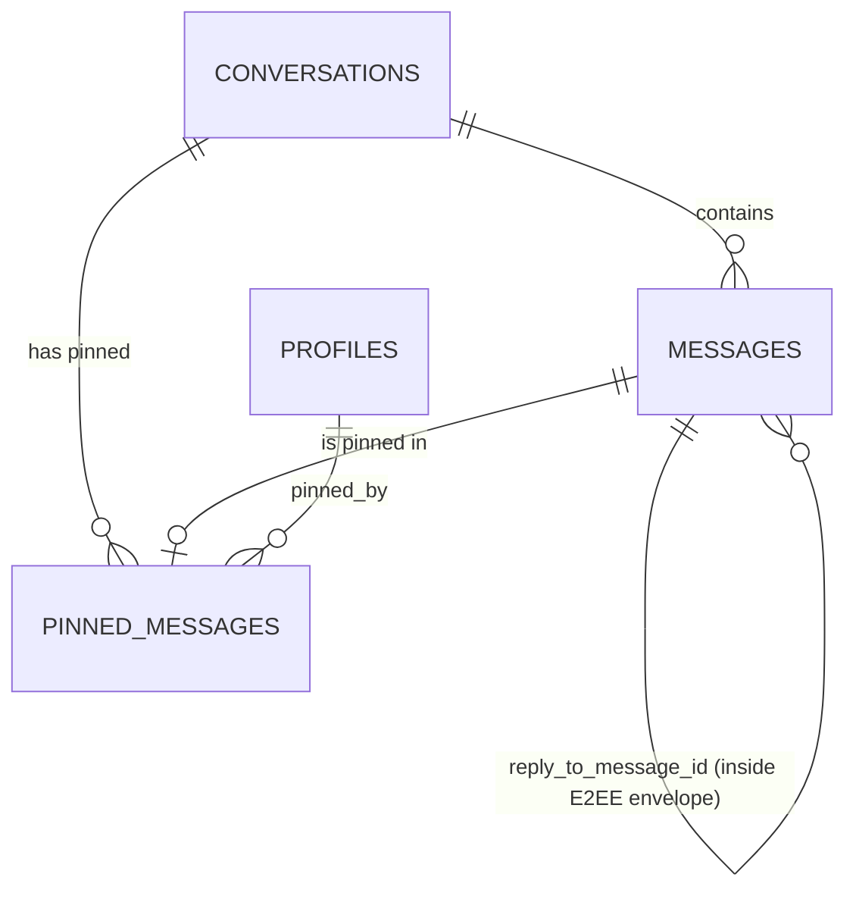

# Phase 1 Data Model: Privacy Focus Blur, Custom Application Icon, Message Replies, and Pinned Messages

**Feature**: `004-privacy-blur-replies-pins`  
**Date**: 2026-11-20  
**Backend**: Supabase (PostgreSQL + RLS + Realtime) & `LocalLoopbackStore`  
**Client Core**: Tauri v2 Rust (`src-tauri/src/`) & React 19 TypeScript (`src/`)

---

## 1. Entity-Relationship Delta Overview



---

## 2. Cryptographic Envelope Extension (`src-tauri/src/crypto/aead.rs`)

### 2.1 `EncryptedMessageEnvelope`

Extends the authenticated JSON payload inside `messages.ciphertext` with an optional parent message UUID:

```rust
#[derive(Debug, Clone, Serialize, Deserialize, PartialEq, Eq)]
pub struct EncryptedMessageEnvelope {
    pub text: Option<String>,
    pub attachment: Option<AttachmentMetadata>,
    #[serde(default, skip_serializing_if = "Option::is_none")]
    pub reply_to_message_id: Option<Uuid>,
}
```

#### Cryptographic & Fail-Closed Validation Rules
1. **Authenticated Encryption & Signature Binding**:
   - `EncryptedMessageEnvelope` is serialized to JSON and encrypted via `ChaCha20-Poly1305` using the message subkey derived from `(epoch_key, message_id, "privatetalk-msg-aead-v1")` and AAD `conversation_id || message_id || epoch`.
   - The sender signs `MSG_SIG_PREFIX || conversation_id || message_id || epoch || nonce || sha256(ciphertext)` with their `Ed25519` private key.
2. **Pre-Send Reply Validation (`message_send_core`)**:
   - When `reply_to_message_id` is provided:
     - Caller MUST be an active member of `conversation_id`.
     - Target parent message MUST exist in `conversation_id`, MUST NOT have `is_removed = true`, and MUST decrypt with `DecryptionStatus::Verified`.
3. **Post-Decrypt Reply Validation (`decrypt_message_row`)**:
   - When `envelope.reply_to_message_id` is `Some(parent_id)`:
     - If `parent_id == row.id` (self-referential cycle), fail closed with `DecryptionStatus::VerificationFailed`.
     - Fetch `parent_row` by `parent_id`:
       - If `parent_row` exists and `parent_row.conversation_id != row.conversation_id` (cross-conversation reply tampering), fail closed with `DecryptionStatus::VerificationFailed` (`text: None`, `attachment: None`, `reply_to: None`).
       - If `parent_row` is `is_removed = true`, resolve `MessageReplyPreviewDto` with `status: DecryptionStatus::Removed`, `text: None`, `has_attachment: false`, `attachment_mime: None`.
       - If `parent_row` fails signature/AEAD verification or is missing, resolve `MessageReplyPreviewDto` with `status: DecryptionStatus::VerificationFailed`, `text: None`, `has_attachment: false`, `attachment_mime: None`.
       - If `parent_row` verifies and decrypts, resolve `MessageReplyPreviewDto` with `status: DecryptionStatus::Verified`, sender display name, latest text snippet (preserving edit state), and attachment indicator.
4. **Edit Preservation (`message_edit_core`)**:
   - Editing a message's text MUST preserve both `envelope.attachment` and `envelope.reply_to_message_id` when re-encrypting and re-signing the updated envelope.

---

## 3. Supabase PostgreSQL Entity (`supabase/migrations/0002_pinned_messages.sql`)

### 3.1 `public.pinned_messages` (Shared Conversation Pinned Messages)

Tracks which messages are currently pinned in a 1-to-1 or group conversation. Contains zero message plaintext.

| Field | Type | Constraints | Description |
|-------|------|-------------|-------------|
| `conversation_id` | `uuid` | `PK`, `REFERENCES public.conversations(id) ON DELETE CASCADE` | Conversation owning the pin |
| `message_id` | `uuid` | `PK`, `REFERENCES public.messages(id) ON DELETE CASCADE` | Pinned message UUID |
| `pinned_by` | `uuid` | `NOT NULL REFERENCES public.profiles(id) ON DELETE CASCADE` | Participant who pinned the message |
| `pinned_at` | `timestamptz` | `NOT NULL DEFAULT now()` | Timestamp when pinned (used for `ORDER BY pinned_at DESC`) |

**Indexes**:
- `PRIMARY KEY (conversation_id, message_id)`
- `CREATE INDEX IF NOT EXISTS idx_pinned_messages_conv_pinned_at ON public.pinned_messages (conversation_id, pinned_at DESC);`

**Row-Level Security (RLS) Policies**:
- `pinned_messages_select_member` (`SELECT`): `public.is_conversation_member(conversation_id, auth.uid())`
- `pinned_messages_insert_member` (`INSERT`):
  ```sql
  pinned_by = auth.uid()
  AND public.is_conversation_member(conversation_id, auth.uid())
  AND EXISTS (
      SELECT 1
      FROM public.messages m
      WHERE m.id = pinned_messages.message_id
        AND m.conversation_id = pinned_messages.conversation_id
        AND NOT m.is_removed
  )
  ```
- `pinned_messages_delete_member` (`DELETE`): `public.is_conversation_member(conversation_id, auth.uid())`

**Automatic Unpin on Message Removal (FR-013)**:
- `public.remove_sent_message(msg_id uuid)` is updated in `0002_pinned_messages.sql` (and mirrored in `LocalLoopbackStore::rpc_remove_sent_message`) to execute `DELETE FROM public.pinned_messages WHERE message_id = msg_id;` atomically when wiping a removed message.

---

## 4. Rust & TypeScript DTOs (`src-tauri/src/commands/mod.rs` & `src/lib/types.ts`)

### 4.1 `MessageReplyPreviewDto`

Represents the quoted parent message summary attached to a reply `MessageDto`:

| Field | Rust Type | TypeScript Type | Description |
|-------|-----------|-----------------|-------------|
| `message_id` | `String` | `string` | Referenced parent message UUID |
| `sender_id` | `String` | `string` | Parent message sender UUID |
| `sender_display_name` | `String` | `string` | Parent message sender display name |
| `status` | `DecryptionStatus` | `DecryptionStatus` | `"verified" \| "verification_failed" \| "removed"` |
| `text` | `Option<String>` | `string \| null` | Decrypted parent text (`null` if removed or verification failed) |
| `has_attachment` | `bool` | `boolean` | `true` only when `status == "verified"` and parent has an attachment |
| `attachment_mime` | `Option<String>` | `string \| null` | Attachment MIME type when `has_attachment == true` |
| `is_edited` | `bool` | `boolean` | Whether parent message was edited |

### 4.2 `MessageDto` (Extended)

Adds reply preview and pin state to `MessageDto`:

| Added Field | Rust Type | TypeScript Type | Description |
|-------------|-----------|-----------------|-------------|
| `reply_to` | `Option<MessageReplyPreviewDto>` | `MessageReplyPreviewDto \| null` | Resolved quoted parent preview when message is a reply |
| `is_pinned` | `bool` | `boolean` | Whether this message is currently pinned in the conversation |
| `pinned_at` | `Option<DateTime<Utc>>` | `string \| null` | Timestamp when pinned (`null` if not pinned) |
| `pinned_by_display_name` | `Option<String>` | `string \| null` | Display name of the participant who pinned it |

### 4.3 `PinnedMessageDto`

Returned by `message_list_pinned` and `message_pin` for rendering the `Pinned` subtab:

| Field | Rust Type | TypeScript Type | Description |
|-------|-----------|-----------------|-------------|
| `conversation_id` | `String` | `string` | Conversation UUID |
| `message_id` | `String` | `string` | Pinned message UUID |
| `pinned_by_id` | `String` | `string` | User UUID who pinned the message |
| `pinned_by_display_name` | `String` | `string` | Display name of user who pinned the message |
| `pinned_at` | `DateTime<Utc>` | `string` | ISO-8601 timestamp when pinned |
| `message` | `MessageDto` | `MessageDto` | Full decrypted `MessageDto` for display in the `Pinned` subtab |

---

## 5. Window Focus Privacy State (`src/App.tsx` & `src-tauri/src/lib.rs`)

Ephemeral UI + native window state governing the full-viewport privacy blur overlay:

| State Property | Type | Source | Transition Rule |
|----------------|------|--------|-----------------|
| `isWindowFocused` | `boolean` | `document.hasFocus()` initial value; updated by `window` `"focus"`/`"blur"`, `document` `"visibilitychange"`, and Tauri `"window:focus_changed"` event | `false` on focus loss or hidden document -> immediately engages full-viewport privacy blur shield (`<100ms`); `true` on focus regain -> immediately clears privacy blur shield |
